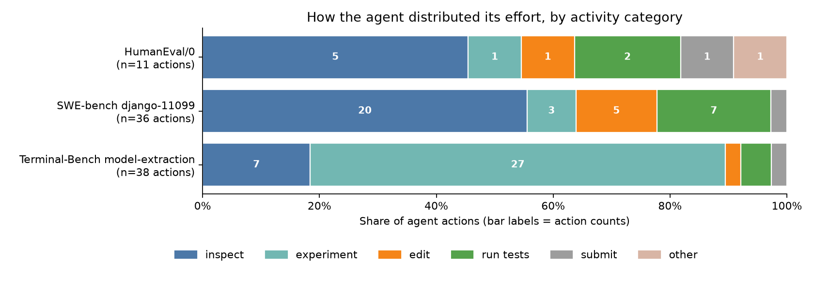
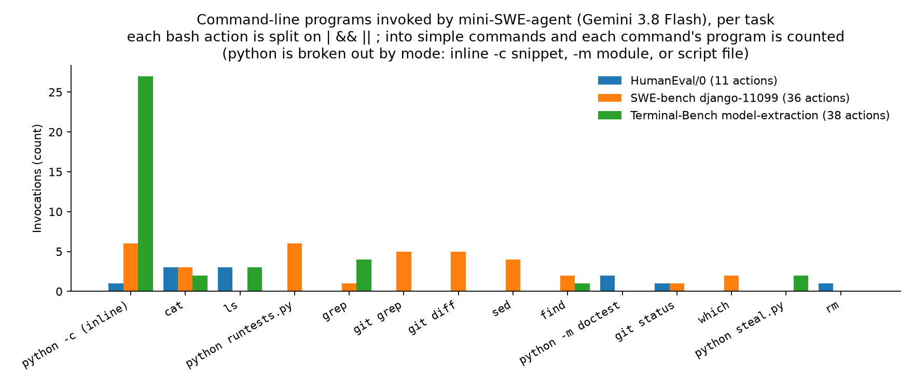
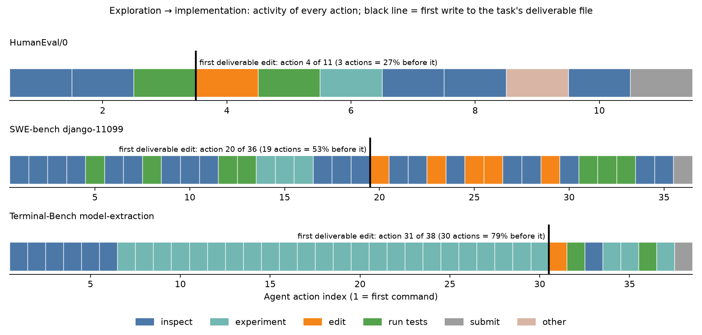

# Section 3: Run Example Tasks

## 3.1 Task 1: HumanEval

**Problem 3 (`run-example-task`)**

1. Which files are available to the agent while it works, and which files become available only during verification? Why does this separation matter?

   While it works, the agent sees only what the `environment/Dockerfile` puts into the image, which here is just `/app/humaneval_0.py`, plus the text of `instruction.md` delivered as its prompt. The `tests/` folder (`test.sh`, `test_outputs.py`) is not in the image; Harbor uploads it to `/tests` only after the agent finishes, and `solution/solve.sh` is uploaded to `/solution` only when the `oracle` agent runs. This separation matters because if the agent could read the hidden assertions or the reference solution, it could easily reward hacks. It also keeps the grading logic out of reach so the agent cannot edit the tests to make them pass.

2. Run `uv run harbor run --help`. Name two agent scaffolds other than `oracle` and two environment backends other than Docker. What distinct role does each category play?

   Two agent scaffolds (`--agent`) are `mini-swe-agent` and `claude-code` (others include `openhands` and `terminus-2`), and two environment backends (`--env`) are `modal` and `daytona` (others include `e2b` and `runloop`). The agent scaffold is the policy being evaluated: it wraps a model (`--model`) with a prompt, a tool interface, and a control loop that decides which action to take next. The environment backend is the infrastructure that provisions and runs the task's container (locally with Docker, or in a cloud sandbox), executes the agent's commands, and later runs the verifier. Keeping these separate lets the same task be run with any agent on any compute provider without changing the task definition.

3. Trace the verification process after the agent finishes: which file does Harbor execute, where do the private tests come from, and how is the final reward communicated back to Harbor?

   After the agent's run ends, Harbor's verifier uploads the task's host-side `tests/` directory into the same container at `/tests` and executes the entry point `/tests/test.sh`, redirecting its stdout to `/logs/verifier/test-stdout.txt`. Here `test.sh` runs `python /tests/test_outputs.py`, which imports `has_close_elements` from `/app` and runs the seven official HumanEval/0 assertions. If the script exits 0, `test.sh` writes `1` to `/logs/verifier/reward.txt`; otherwise it writes `0`. Harbor then downloads `/logs/verifier/` into the trial's `verifier/` folder and parses `reward.json` if it exists, else `reward.txt`, which becomes `verifier_result.rewards.reward` in the trial's `result.json`. For the oracle run, `humaneval-oracle/humaneval-0__LquC9Hg/verifier/reward.txt` contains `1`.

**Problem 4 (`run-example-agent`)**

1. Summarize the agent's approach. Which files and commands did it use?

   The agent took 11 actions (trajectory steps 3–13) over about 30 seconds of agent time (2 min 16 s for the whole trial including container setup), using 31,453 prompt and 2,603 completion tokens. It read the code with `cat /app/humaneval_0.py` (step 3), listed `/app` (step 4), and ran `python3 -m doctest` to confirm the stub failed (step 5). It then overwrote the file with a heredoc implementing a sort-then-compare-adjacent algorithm (step 6), re-ran the doctests (step 7), and ran an inline `python3 -c` script with the seven HumanEval assertions plus edge cases such as empty lists, negatives, duplicates, and a zero threshold (step 8). It finished with housekeeping: a failed `git status` (step 9, not a repository), deleting `/app/__pycache__` (step 11), and submitting with `echo COMPLETE_TASK_AND_SUBMIT_FINAL_OUTPUT` (step 13). The only file it touched was `/app/humaneval_0.py`.

2. Identify one decision in the trajectory that helped or hurt the final result. Cite the relevant step.

   In step 6 the agent reasoned explicitly about whether "two distinct numbers" meant distinct values or distinct positions. It noticed that the case `[1.0, 2.0, 3.0, 4.0, 5.0, 2.0], 0.1` must return `True` because 2.0 appears twice, so it treated duplicates at different indices as a close pair. That decision helped: an implementation that deduplicated values (for example, via `set(numbers)`) would have failed that hidden assertion. The sorted adjacent-difference approach it chose handles duplicates naturally (difference 0.0 < threshold) and runs in O(n log n). However, the agent recited the official HumanEval/0 assertions from memory in step 6, which suggests benchmark contamination: it may have known the hidden tests rather than inferring the edge case from the spec.

3. Did the verifier reward accurately reflect the quality of the agent's solution? Why or why not?

   Yes. The reward of 1 (`humaneval-agent/humaneval-0__H9nCfVC/verifier/reward.txt`) matches a solution that is correct by inspection: after sorting, the closest pair must be adjacent, so checking adjacent differences with a strict `<` exactly implements the specification, including empty and single-element lists. The verifier is weak, however: it has only seven hand-picked assertions and would also pass some incorrect solutions, such as code that special-cases these inputs. Its binary reward also cannot reflect quality differences like efficiency (the oracle's O(n²) double loop and the agent's O(n log n) solution both score 1). So the reward is accurate here because the solution is correct, not because the verifier is thorough.

## 3.2 Task 2: SWE-bench Verified

**Problem 5 (`run-swebench-agent`)**

1. Summarize the agent's approach. How did it locate the relevant code, and what change did it make?

   The agent located the code directly from the issue text: `find . -name "validators.py" | grep auth` (step 3) returned `django/contrib/auth/validators.py`, which it read (step 4), and `git grep -l "ASCIIUsernameValidator"` (step 5) pointed it to the existing tests in `tests/auth_tests/test_validators.py`. After establishing a passing baseline of 22 tests (step 10), it reproduced the bug with an inline script showing that both validators accepted `'test\n'` (step 17). It then rewrote `validators.py` so both `ASCIIUsernameValidator` and `UnicodeUsernameValidator` use `r'\A[\w.@+-]+\Z'` instead of `r'^[\w.@+-]+$'` (step 22). It also added a `"string\n"` case to both validator tests (steps 25–32) and re-ran `auth_tests.test_validators` and `validators` before submitting (steps 33–35). Across its 36 actions it used 324,109 prompt tokens (237,743 cached) and 4,890 completion tokens.

2. Identify one point where the agent used repository context that would not exist in a self-contained HumanEval task.

   In steps 13–16 the agent ran `git grep "UsernameValidator"` and found that `UnicodeUsernameValidator()` is referenced in four auth migrations (e.g. `0001_initial.py`, `0008_alter_user_username_max_length.py`). It worried that changing the regex would require a new migration, so it checked `UnicodeUsernameValidator().deconstruct()` and found it returns `('django.contrib.auth.validators.UnicodeUsernameValidator', (), {})`. Because the regex is not serialized into migrations, the change was safe. In steps 19–21 it also inspected `django/core/validators.py` and noticed Django's own validators (e.g. `slug_re = r'^[-a-zA-Z0-9_]+\Z'`) already use `\Z`, and that `RegexValidator.__call__` uses `regex.search`. None of this context (migrations, serialization, project conventions) exists in a single-function HumanEval task.

3. Compare this trajectory with the HumanEval trajectory. What made this task more difficult to understand, modify, or verify?

   The SWE-bench run needed 36 actions against HumanEval's 11 and roughly 10× the prompt tokens (324k vs. 31k). Understanding was harder because the agent had to find the code in a large repository and reason about side effects (migrations, `deconstruct()`) that the issue never mentions. Verification was the biggest difference: the first test run failed with `ModuleNotFoundError: No module named 'django'` (step 7), forcing the agent to discover the `testbed` conda environment (steps 8–10). Broader suites such as `runtests.py migrations` (step 15) and `runtests.py auth_tests` (step 34) also hit mini-SWE-agent's 30-second command timeout, so it fell back to narrower test modules. Modifying was harder too: editing the test file via `python -c` string replacement took three attempts (steps 25–32) because of shell- and Python-escaping errors.

4. Did the final reward accurately reflect the quality of the agent's solution? Support your answer with evidence from the verifier logs.

   Yes: the reward is 1, and `verifier/report.json` shows `"patch_successfully_applied": true` and `"resolved": true`, with all 3 FAIL_TO_PASS tests passing (including `test_ascii_validator` and `test_unicode_validator`, which the test patch extends with `'trailingnewline\n'`), all 19 PASS_TO_PASS tests passing, and no regressions. The verifier first runs `git checkout` on `tests/auth_tests/test_validators.py`, discarding the agent's own test edits before applying the official test patch, so the agent could not influence its own grading. It also accepted a solution that differs from the reference (the oracle's `r'^[\w.@+-]+\Z'` vs. the agent's `r'\A[\w.@+-]+\Z'`), which is correct because without `re.MULTILINE`, `^` and `\A` both match only at the string start. One limitation is that the verifier runs only `auth_tests.test_validators`, but since the change is confined to two class attributes, that narrow scope is reasonable.

## 3.3 Task 3: Terminal-Bench 2.1

**Problem 6 (`run-terminal-bench-agent`)**

1. Summarize the agent's approach. What information did it gather, and what solution strategy did it pursue?

   The agent first inspected the environment (`ls -la /app`, `cat /app/forward.py`, a failed `git log`, a `find` for test/eval files, and `ls /root`; steps 3–7) and learned that the visible network has a 20×10 `A1` that it could also read directly (`forward.A1.shape`, step 10). Its strategy exploited the network's piecewise linearity: along a random line x₀ + t·v, the directional derivative of `forward` jumps exactly where some hidden neuron's pre-activation crosses zero, and the change in the full gradient at that point is proportional to that neuron's row of `A1`. Its final `steal.py` (step 33) scans 4,000 points of t ∈ [−10, 10] with finite differences, flags jumps larger than `1e-3 ×` the largest jump, bisects each jump to localize it, and takes the normalized gradient difference as a row of `A1`. It repeats this over random lines, deduplicating rows with |cos| > 0.999, until 8 consecutive lines find nothing new. The run took 38 actions over about 4.5 minutes, using 598,960 prompt tokens (464,721 cached) and 16,823 completion tokens.

2. Identify one point where the agent made meaningful progress and one point where its approach broke down or became unproductive.

   Meaningful progress came in steps 21–22: dense sampling of the directional derivative along one line recovered 17 rows, each with cosine 1.0 to a true row, and combining several random lines recovered all 20 neurons ("Final recovered count: 20"). Earlier, in steps 16–18, a recursive bisection on full-gradient differences was unproductive, reporting "Found 10 boundary intervals / Recovered 0 vectors" and then only 2 neurons before the agent abandoned it. More importantly, its validation broke down: it checked its work against the ground-truth `forward.A1` (referenced in 16 of 38 actions) using cosine similarity > 0.9999 (step 39), never against the verifier's actual criterion (elementwise ratio agreement within `1e-4`). Its end-to-end tests of `steal.py` on other networks (step 37) also all used weight scale 0.1, not the larger scale the hidden network turned out to use. As a result it submitted a script that it believed worked perfectly but that missed rows of the hidden network.

3. What evidence does the verifier provide beyond the scalar reward? Does it capture partial progress on this task?

   Beyond `reward.txt` (0), the verifier writes `test-stdout.txt` with the full pytest failure, `AssertionError: Failed to match rows: [4, 6, 23]`, and a CTRF report (`verifier/ctrf.json`) with the test's status and duration. Because `test_outputs.py` first overwrites `forward.py` with a different network (30 hidden neurons, `np.random.seed(5)`, weights ×0.3), the log reveals that the agent's `steal.py` generalized to an unseen network and matched 27 of 30 rows. When I replayed `steal.py` locally against that hidden network, it returned only 28 rows, and the unmatched rows had best cosine matches of only 0.68 and 0.10, so the failure was mostly missed neurons rather than imprecise ones. All three failed rows have below-median output strength $\|A2_i\| \cdot \|A1_i\|$, which suggests the relative jump threshold contributed to dropping them. The binary reward collapses this 90% recovery into 0: the verifier records partial progress in its logs, but the reward does not capture it.

4. How did the open-ended terminal environment affect the agent's ability to plan, test its assumptions, and recover from mistakes?

   The terminal let the agent turn a research problem into fast empirical iteration: it wrote 27 inline `python3 -c` experiments, measured query cost (2,000 calls in 0.068 s, step 26), and built simulated networks to test robustness to width and weight scale (steps 29–30, 37). It could also recover cheaply from a dead end, dropping the failed bisection approach (steps 16–18) for dense sampling (steps 19–22). The same openness hurt it, though: because `forward.py` exposed `A1` in plain text, the agent anchored its validation on the visible ground truth and its own cosine metric rather than planning for the stated constraint that the shape and weights are unknown. Its end-to-end checks of `steal.py` also used weight scale 0.1 instead of the hidden 0.3. With no tests visible and no feedback until after submission, the environment rewarded self-designed verification, and the agent's verification was looser than the hidden one.

## 3.4 Analyzing Agent Trajectories

**Problem 7 (`analyze-trajectories`)**

All three figures are generated by [`analyze_trajectories.py`](analyze_trajectories.py) (`uv run python writeup/3_run_example_tasks/analyze_trajectories.py`) from each run's `agent/trajectory.json`. An *action* is one `execute_bash` command; action *k* corresponds to trajectory step *k* + 2, since steps 1–2 are the system and task prompts. Every action is assigned exactly one category by ordered rules defined in the script: **submit** (completion sentinel); **edit** (writes or reverts a file: heredoc or `>` redirect into a file, `sed -i`, `patch`, `git checkout/apply`, Python `open(..., "w")`); **run tests** (a test runner such as `doctest` or Django's `runtests.py`, or executing a script file); **experiment** (an inline `python -c` snippet); **inspect** (only read-only programs such as `cat`, `ls`, `grep`, `find`, `sed -n`, `git grep/diff/status`); and **other**. I (and Claude) hand-checked the category of all 85 actions.

### `effort-distribution.png`

How did the agent distribute its effort across activities such as inspecting files, editing code, running tests, and debugging?

The figure shows each task's share of actions per category, with action counts labeled on the bars. HumanEval and SWE-bench share an inspect-heavy software-engineering profile (5/11 and 20/36 actions inspecting), though only one of SWE-bench's 5 edits is the actual fix (the other four went into adding a regression test), whereas Terminal-Bench is dominated by inline Python experiments (27 of 38 actions, 71%) with a single edit. This shows the agent treated model extraction as a research problem, iterating on hypotheses in throwaway snippets, rather than as a code-modification problem.

### `bash-command-usage.png`

`mini-SWE-agent` performs its work through `execute_bash`. What command-line programs and command patterns did it use across the three trajectories, and how did their use vary by task?

I split each bash action into simple commands on `|`, `&&`, `||`, and `;` with quote-aware tokenization (heredoc and `-c` bodies excluded), then counted each command's program, breaking `python` out by mode (`-c` inline, `-m` module, or script file) and `git` by subcommand. The toolkit was small and task-shaped: only SWE-bench used repository-navigation tools (`git grep` 5, `git diff` 5, `sed -n` ranges 4) and a test runner (`python runtests.py` 6), Terminal-Bench was dominated by `python -c` (27 calls), and HumanEval needed little beyond `cat`, `ls`, and `python -m doctest`. Notably, the agent never wrote a reusable helper script, even though it re-defined the same `grad_at` helper in 12 separate Terminal-Bench snippets.

### `exploration-to-implementation.png`

At what points did each agent appear to transition from exploring the task to implementing a solution? Define how your visualization identifies that transition.

Each row shows one task's actions in order, colored by category, with a black line at the transition, which I define as the first action that writes the task's **deliverable** file (`/app/humaneval_0.py`, `django/contrib/auth/validators.py`, or `/app/steal.py`), since edits to scratch or test files do not implement the solution. The transition came at action 4 of 11 on HumanEval (27% of actions spent exploring), action 20 of 36 on SWE-bench (53%), and action 31 of 38 on Terminal-Bench (79%). On SWE-bench, exploration meant understanding an existing system, while on Terminal-Bench it meant inventing an algorithm through experiments, after which the agent wrote `steal.py` once and only validated it, leaving no room to revise the algorithm once it passed its own looser check.
